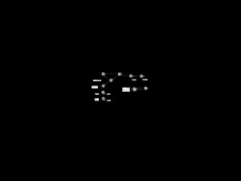
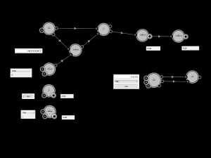
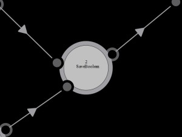
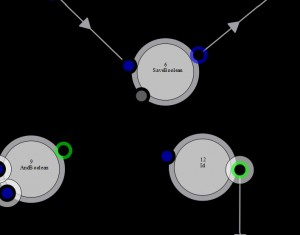
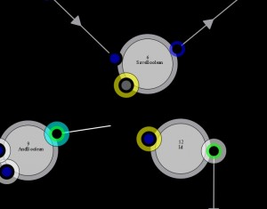
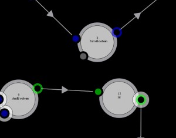

    <h1>Concepts (2.0.6)</h1>		

<!-- END page-heading -->

Cameleon is a new free &#038; open source language based on an abstract functional grammar &#038; a glossary divided in specifics working fields dictionaries. The grammar is based on a petri net extension with a mathematical formalism described in <a href="http://arxiv.org/abs/1110.4802">Cameleon grammar, a petri net extension</a>. The language can be edited graphically using the Cameleon Algorithm Editor to create Cameleon program, named composition. The language glossary can be extended with new fields dictionaries using the Cameleon Dictionary Development Kit (DDK) to create Cameleon dictionary, a collection of words, them-self named operators. Cameleon language aims to simplify &#038; accelerate software development by using a high-level bottom-up approach.

With a simple drag &amp; drop mechanism, you can create an image processing prototype where the calibration is done in real-time. In Caméléon creator, code is a graphical data(work)-flow interpreted and executed by the Caméléon Virtual Machine with a mathematical equivalence &amp; a XML equivalence.

Before following tutorial or references to build your prototypes, you must know how to read the Caméléon language. To do so, you have to understand deeply Caméléon&#8217;s inner concepts. 

 
<strong>An operator</strong> is an independent software component using input data x to produce output data y. An operator is like a <a href="http://en.wikipedia.org/wiki/Function_(mathematics)">mathematical function</a> f, f(x) = y. 
An operator has a graphical representation: a circle including its name and surrounded by little circles representing input (little circles including little black circles) and output (little circles including big black circles) datas.

 
 
 
<em>Figure 1 &#8211; An operator and its equivalence</em> 

<strong>Note:</strong> It exists a functional equivalence between operator, <a href="http://en.wikipedia.org/wiki/Function_(mathematics)">mathematical function</a> &#038; <a href="http://en.wikipedia.org/wiki/Subroutine">computer science function</a>. This is a good way to organize knowledge &#038; know-how.

 
Little circles surrounding the operator represents input &#038; output data and are named connectors. A connector hold a data and gives the ability to connect itself to another connector in order to share its data. All data has a type (NUMBER, STRING, IMAGE &#8230;).

 
 
 
<em>Figure 2 &#8211; A first connection</em> 

An equivalence to Figure 2 is f(x)=y; g(y)=z.

Connection condition: You can only connect output connectors to input connectors with the same type or with a generic type. A connected connector cannot be connected to another connector.

A connection is represented by a line with an arrow showing the direction of the connection.

 
 
 
<em>Figure 3 &#8211; A connection, a is shared to b</em> 

 
<strong>A control</strong> is an independent software component using input data x to produce output data y with a graphical user interface enabling the user to view and/or manipulate data. y=g(x), the function g is a human action.

 
 
 
<em>Figure 4 &#8211; A control</em> 

Inputs and outputs data are representing by connectors as we do for the operator. Those connectors can be connected to operator&#8217;s connector.

 
 
<em>Figure 5 &#8211; A control connection</em> 

It exists different kinds of controls.

 
 
 
<em>Figure 6 &#8211; Controls</em> 

 
<strong>A dictionary</strong> is a separate Caméléon Editor plugin as a shared library offering several components (operator, control &#8230;) to enrich Caméléon Editor with new independent software component to play with.

<strong>Note:</strong> You can add your own C++ component dictionary using the Caméléon Development Kit. Generally, dictionaries addresses specifics business fields. For instance, Population Dictionary target image processing &#038; analysis in material science.

 
<strong>A composition</strong> is a set of connected operators &#038; controls combined to process specifics numerical tasks. It&#8217;s a computer program with a graphical representation. A composition is also named a prototype.

 
 
<em>Figure 7 &#8211; A composition</em> 

 
<strong>A sub composition</strong>, or a <strong>sub process</strong>, is a set of connected operators &#038; controls aggregate under a graphical grey element. It&#8217;s a graphical view to simplify &#038; organize a composition. You can browse a sub composition and modify its content.

 
 
<em>Figure 8 &#8211; A sub composition, outer &#038; inner view</em> 

 
<strong>A pattern</strong> is a reusable sub composition. The pattern creation is the same as the operator creation. A pattern is represented by a *.pa XML file in the pattern directory of the Caméléon instance directory. This file is sharable and can be used in all Caméléon instance.

 
 
<em>Figure 9 &#8211; Pattern &#038; pattern directory</em> 

 
<strong>An interface</strong> is a composition composed exclusively by controls &#038; managed by the controller window.

 
 
<em>Figure 10 &#8211; Interface</em> 

A composition can be launched &#038; stopped.

<strong>The execution</strong> is directed by inputs &#038; outputs data. To know more about inner mechanics, please see <a href="http://arxiv.org/abs/1110.4802">the theory article</a>. 

Connectors as a status regarding its inner data: NEW (GREEN), EMPTY (GREY) or OLD (BLUE).

 
 
<em>Figure 11 &#8211; Connectors statuses</em> 

Operator as a status regarding its execution: RUNNABLE (GREEN), NOTRUNNABLE (GREY), RUNNING (YELLOW), ERROR (RED). 
An operator can only be runned if its <strong>execution condition</strong>, regarding connector statuses, is verified.

 
 
<em>Figure 12 &#8211; Operator statuses</em> 

The standard execution condition is as follow: 
* inputs datas are NEW or OLD with a minimum of one input at NEW, 
* outputs datas are OLD or EMPTY.

Execution condition can be standard or specific to an operator. Please see the component specification &#038; documentation (<a href="http://www.shinoe.org/cameleon/scd-reference/">SCD</a>, <a href="http://www.shinoe.org/cameleon/population-dictionary-reference/">Population</a>).

 
 
<em>Figure 13 &#8211; A composition execution</em> 

For instance, on the Figure 13, at execution time, if X is NEW, f is executed and produce Y. Then Y is dumped into Y&#8217;, then g is executed and produce Z.

 
 
<em>Figure 14 &#8211; An other composition execution</em> 

<strong>Note</strong>: At second execution of this part of the composition, the flow cardinality before &#038; after h is disturbed. Cb < Ca. We need to synchronize the two h inputs with a synchronous operator with a different kind of execution condition.

 
 
<em>Figure 15 &#8211; Yet an other composition execution</em> 

 
Merge doesn&#8217;t need a data available in the two inputs data to be RUNNABLE. 
Study the merge documentation and understand that it exists different kind of execution condition. You have to master them if you want to create robust prototypes. 

<strong>Update function</strong>. 
if example

<strong>Some screen shots</strong>

