

<a href="#introduction">Introduction</a>

<a href="#install">Install &#038; Launch</a>

<a href="#instance">Instance</a>

<a href="#Composer">Composer</a>

<a href="#OperatorConnector">Operator &#038; Connector</a>

<a href="#Controls">Control</a>

<a href="#SubComposition">Sub process &#038; Patterns</a>

<a href="#TextShape">Text &#038; Shape</a>

<a href="#Navigation">Navigation</a>

<a href="#Controller">Controller</a>

<a href="#Project">Project</a>

<a href="#Properties">Properties</a>

<a href="#Error">Error</a>

<a href="#CLI">Command Line Interface</a>

  

 
<strong> 
<h2>Introduction</h2>

<a href="#">back to top</a>
	

</strong> 
<a href="./concepts.md">Concepts article</a> is a good start to understand Caméléon underlying concepts. 

<a href="img/Navigation001.jpg">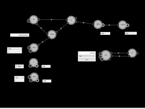</a> 
<em>Figure 1 &#8211; A composition</em> 

Caméléon is a graphical algorithm editor. You can combine elementary components to create new compositions [Fig. 1]. All component construction features are based on a drag &#038; drop mechanism.

Caméléon allow the creation of those components: 
* <strong>Operator</strong>: Like a mathematical function, an operator, f, produces output data, y, from input data, x, as follows y = f(x). An operator (big center circle) has some input connector containing input data (little black circles including little colored or gray circles) and some output connector containing output data (little colored or gray circles including black circles). 
* <strong>Control</strong>: A control is an elementary component to manipulate, set or view datas. It can be connected to operators inputs &#038; outputs. 
* <strong>Pattern</strong>: A pattern is a set of operators &#038; controls aggregate in an elementary component. From a part of a composition you can create a sub composition, a sub process. A sub composition is reusable &#038; sharable as pattern. 
* <strong>Text &#038; Shape</strong>: Text &#038; Shape are used to structure &#038; comment compositions.

<h2><strong>Install &#038; Launch</strong></h2>
If your want to install a pre-build version: 
* Follow this link to <a href="./install_windows.md">install Caméléon on windows 7 à 10</a>, 
* Follow this link to <a href="./install_debian.md">install Caméléon on debian</a>. 
 
If your want to build your own version: 
* Follow this link to <a href="./build_debian.md">install Caméléon on windows 7 à 10</a>, 
* Follow this link to <a href="./build_windows.md">build Caméléon on linux debian</a>. 

 
<strong> 
<h2>Instance</h2>

<a href="#">back to top</a>
	

</strong> 
A Caméléon instance is a directory holding all files, binaries needed to execute Caméléon Editor. 
In the Caméléon, some directories and files are available:

<pre>
/log
/ressource
/pattern
/project
instance.conf
[on linux] cameleon
[on windows] cameleon.exe
</pre>

The root directory contains all binaries to execute Caméléon. 
The log directory contains all Caméléon instance log files. 
The ressource directory contains all ressource file needed by Caméléon (images &#8230;). 
The pattern directory is the directory where patterns are stored by Caméléon Creator. 
The project directory contains example projects. This directory must be used to store your projects. 
The instance.conf file is an XML configuration file for Caméléon. 

 
<strong> 
<h2>Composer</h2>

<a href="#">back to top</a>
	

</strong> 
The composer allows to create and connect graphically elementary components (operator, controls, patterns) to build new composition. 

<a href="img/Composer.jpg">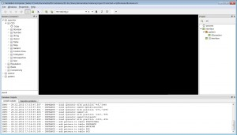</a> 
<em>Figure 2 &#8211; The composer</em> 

* <strong>Menu Bar</strong> [Fig. 3]: The menu bar gives you access to management features 
* <strong>Player Bar</strong> [Fig. 5]: Start, pause &#038; stop the engine. You can either launch the engine step by step. 
* <strong>Mode Bar</strong> [Fig. 6]: Three editing modes are available; composition (arrow icon), shape (square icon) &#038; text (A icon). 
* <strong>Comment Bar</strong> [Fig. 7]: Set up text &#038; shape style &#038; color. 
* <strong>Glossary Tree</strong> [Fig. 4]: The glossary is like a component repository. You can create component from here. 
* <strong>Project Tree</strong>: The project tree expose your prototype structure. You can navigate through sub processes &#038; interfaces. You can add or delete interfaces. 
* <strong>Composition View</strong>: The black center square. This is the place to create operators, controls &#038; set up compositions. 
* <strong>Caméléon Outputs</strong>: At the bottom, two tabs are available. The first, consol outputs, shows all Caméléon outputs. To set console outputs, go to windows > properties > project  > Consol Outputs, set outputs to enable &#038; select your outputs level for each logs. The second, Executions problems, shows all execution problmes actualy avaible. By clicking on them, the system highlight the erroneous component.

<h3 style="text-align: left;">Menu</h3>

Menu gives access to saved file manager, properties etc. 

<a href="img/Composer_Menu.jpg">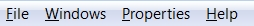</a> 
Figure 3 &#8211; Menu Bar 

* <strong>File</strong>: Save &#038; Load Caméléon *.cm files. 
* <strong>Windows</strong>: Hide &#038; Show windows. 
* <strong>Properties</strong>: Go to project or instance properties dialogs. 
* <strong>Help</strong>: Go to Caméléon web site to find information.

<h3 style="text-align: left;">Glossary</h3>

The glossary gives access to all components which can be created by Caméléon Creator. 

<a href="img/Composer_Glossary.jpg">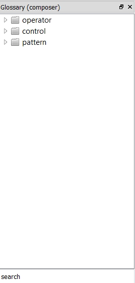</a> 
Figure 4 &#8211; Glossary 

The glossary is a tree list view which exposed all components which can be created. 
The glossary is devided in three parts: 
* <strong><a href="concepts.html#operator">Operator</a></strong>: Set of all available algorithms. Directories under the Operator directory are named glossary. 
* <strong><a href="concepts.html#control">Control</a></strong>: Set of all available controls. Directories under the Control directory are named glossary. 
* <strong><a href="concepts.html#pattern">Pattern</a></strong>: Set of all available user created patterns. 

<strong>Browse the glossary</strong>: 
1- Open a component directory, 
2- Little <strong>O</strong> icons identify components which can be created. Drag &#038; Drop it to the composition view to create a component. 

<strong>Search an operator</strong>: 
1- Click on the search edit box, 
2- Write a key word to search, 
3- The search tool highlight corresponding components.

<h3 style="text-align: left;">Player Bar</h3>

The player bar allow you to launch or stop the Caméléon engine. 

<a href="img/Composer_Player_Bar.jpg">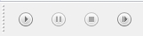</a> 
Figure 5 &#8211; Player Bar 

* <strong>Run</strong>: to launch the composition execution, 
* <strong>Pause</strong>: to pause the execution, 
* <strong>Stop</strong>: to stop the execution, 
* <strong>Next step</strong>: in pause mode, allow you to process one next operator.

<h3 style="text-align: left;">Mode Bar</h3>

The mode bar allows to change the edition mode. 

<a href="img/Edit_Mode.jpg">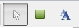</a> 
Figure 6 &#8211; Mode Bar 

* <strong>Composition Mode</strong>: The mode to compose with operators &#038; controls, 
* <strong>Shape Mode</strong>: The mode to draw shapes, 
* <strong>Text Mode</strong>: The mode to write text (comments &#8230;).

<h3 style="text-align: left;">Comment Bar</h3>

The comment bar allow to manage text style &#038; shape colors. 

<a href="img/Editor_Options.jpg">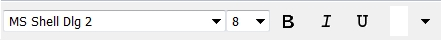</a> 
Figure 7 &#8211; Comment Bar 

Those actions has effect on selected texts. Multiple selection is allowed. 
* <strong>Police selector</strong>: Change selected text police, 
* <strong>Size selector</strong>: Change selected text size, 
* <strong>Bold button</strong>: Change selected text to Bold, 
* <strong>Italic button</strong>: Change selected text to italic, 
* <strong>Underline button</strong>: Underline selected text,

This action has effect on selected texts &#038; shape. Multiple selection is allowed. 
* Color selector: Change selected text or shape color.

<h3 style="text-align: left;">Bring &#038; Send</h3>

The bring &#038; send bar allows to manage component Z axis. 

<a href="img/Up_Down.jpg">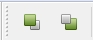</a> 
Figure 8 &#8211; Bring &#038; Send 

Those actions has effect on selected components. Multiple selection is allowed. 
* <strong>Bring to front</strong>: Bring selected components to front, 
* <strong>Send to back</strong>: Send selected components to back.

<h3 style="text-align: left;">File Menu</h3>

File menu allows to manage load &#038; save project. 

<a href="img/Menu_File.jpg">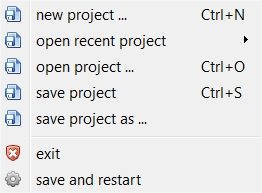</a> 
Figure 12 &#8211; File Menu 

* <strong>new Project &#8230;</strong>: Create a new project, 
* <strong>open recent project</strong>: Open a recent project list. Select a project to open it, 
* <strong>open project &#8230;</strong>: Open a project on your computer, 
* <strong>save project</strong>: Save a project on your computer, 
* <strong>save project as &#8230;</strong>: Save a project in a specific directory, 
* <strong>exit</strong>: Close Caméléon, 
* <strong>save and restart</strong>: Save and restart Caméléon.

<h3 style="text-align: left;">Windows Menu</h3>

The windows menu allows to manage windows visibility. 

<a href="img/Menu_Windows.jpg">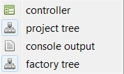</a> 
Figure 9 &#8211; Windows Menu 

* <strong>controller</strong>: Show/Hide the controller window, 
* <strong>project tree</strong>: Show/Hide project tree, 
* <strong>console output</strong>: Show/Hide console outputs, 
* <strong>glossary tree</strong>: Show/Hide glossary tree.

<h3 style="text-align: left;">Properties Menu</h3>

The properties menu allows to manage instance &#038; project properties. 

<a href="img/Menu_Properties.jpg">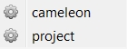</a> 
Figure 10 &#8211; Properties Menu 

* <strong>cameleon</strong>: Show Caméléon properties dialog, 
* <strong>project</strong>: Show project properties dialog.

<h3 style="text-align: left;">Help Menu</h3>

Help menu gives access to support &#038; documentation web links. 

<a href="img/Menu_Help.jpg">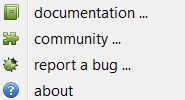</a> 
Figure 11 &#8211; Help Menu 

* <strong>documentation &#8230;</strong>: Open online documentation in a web browser, 
* <strong>community &#8230;</strong>: Open community links in a web browser, 
* <strong>report a bug &#8230;</strong>: Open the online contact form, 
* <strong>about</strong>: Open the about dialog (Caméléon version &#038; licence are available from here).

 
<strong> 
<h2>Operator &#038; Connector</h2>

<a href="#">back to top</a>
	

</strong>

<h3 style="text-align: left;">Create &#038; move an operator</h3>

<a href="img/Operator000.jpg">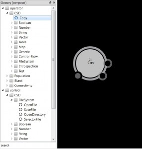</a> 
Figure 12 &#8211; Create an operator 

1- Identify the operator you want to create by browsing or searching the glossary, 
2- Operators are available behind the &#8220;operator&#8221; directory and are identified by a <strong>O</strong> icon, 
3- Drag the operator&#8217;s name from the glossay and drop it in the composition view, 
4- It creates an operator at the dropping position, 
5- You can drag &#038; drop it on the composition view to change its position (also works in multi selection).

<h3 style="text-align: left;">Operator &#038; Connector Statuses</h3>

The operator status gives information about its execution. 

<a href="img/runnable.jpg">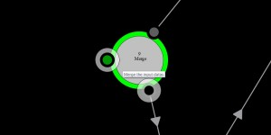</a><a href="img/running.jpg">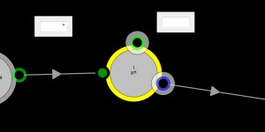</a><a href="img/error.jpg">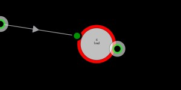</a> 
Figure 19 &#8211; Operator statuses 

 
* <strong>Runnable</strong>: Green color. The operator can be executed. 
* <strong>Running</strong>: Yellow color. The operator is being executed. 
* <strong>Not Runnable</strong>: Gray color. The operator can not be executed by the CVM. 
* <strong>Error</strong>: red color. An error occurred on this operator.

Connector status gives information about the connector&#8217;s data. 

<a href="img/New.jpg">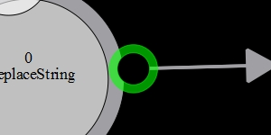</a><a href="img/Old.jpg">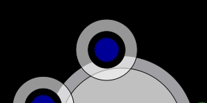</a> 
Figure 20 &#8211; Connector statuses 

 
* <strong>Empty</strong>: Gray color. No data available in the connector. 
* <strong>New</strong>: Green color. A new data is available in the connector. 
* <strong>Old</strong>: Blue color. An old data -means already used by an operator, is available in the connector.

<h3 style="text-align: left;">Change connector position</h3>

Organize simply the composition changing connector&#8217;s position. 

<a href="img/Operator001.jpg">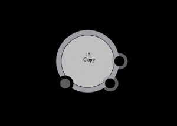</a><a href="img/Operator002.jpg">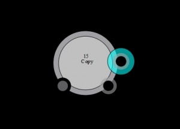</a><a href="img/Operator003.jpg">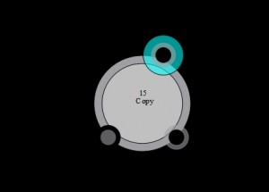</a> 
Figure 13 &#8211; Change connector position 

1- Drag a connector to another position, 
2- Be careful to keep your mouse into the connector circle, 
3- Drop the mouse to set the connector position.

<h3 style="text-align: left;">Show operator information</h3>

<a href="img/Operator005.jpg">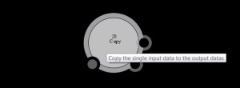</a> 
Figure 14 &#8211; Show operator information 

Hoover your mouse on an operator or a connector to show information. Select one or more component, press the &#8216;W&#8217; key to show more informations.

<h3 style="text-align: left;">Operator Menu</h3>

Right Click on an operator to show the menu. 

<a href="img/Operator_Menu.jpg">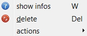</a> 
Figure 15 &#8211; Operator Menu 

* <strong>show infos</strong>: As &#8216;W&#8217; key press, it shows operator description, 
* <strong>delete</strong>: delete the operator. 
* <strong>(optional) actions</strong>: can expose operator specific actions.

<h3 style="text-align: left;">Connection</h3>

<a href="img/Connection001.jpg">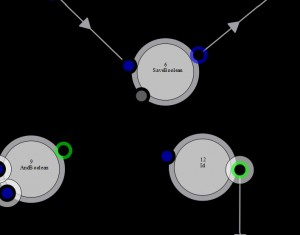</a><a href="img/Connection002.jpg">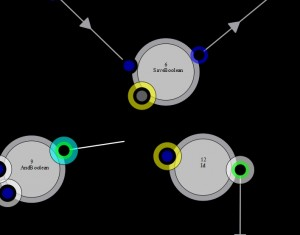</a><a href="img/Connection003.jpg">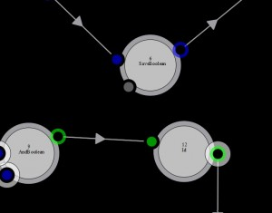</a> 
Figure 18 &#8211; Connection 

1- Drag a connector from its position to somewhere on the composition view, 
2- It shows compatible connectors (identified with yellow circles), 
3- Drop on a compatible connector to connect.

After a connection, when a data will be available on output connector, it will be automatically dumped into input connector.

<strong>Note</strong>: Some datas are shared by reference or by value. The next 2.0.8 version will expose this characteristic more clearly.

<h3 style="text-align: left;">Connector Menu</h3>

Right click on a connector to show the connector contextual menu. 

<a href="img/Connector_Menu.jpg">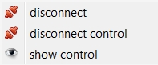</a> 
Figure 21 &#8211; Connector Menu 

* <strong>disconnect</strong>: disconnect the connector, 
* <strong>disconnect control</strong>: disconnect the connector from a control connector, 
* <strong>show control</strong>: show the control connector connected to this connector.

<h3 style="text-align: left;">Multi Selection</h3>

<a href="img/MultiSelect.jpg">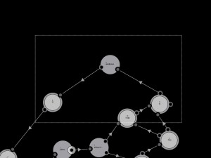</a> 
Figure 16 &#8211; Multi Selection 

1- Drag the mouse from an empty space on the composition view to somewhere, 
2- It draws a selection square, 
3- Drop somewhere, 
4- It selects components which are under the selection square.

After multi-selection, click right somewhee to show the multi-selection contextual menu.

<a href="img/Operator_MultiSelection_Menu.jpg">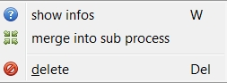</a> 
Figure 17 &#8211; Multi Selection Menu 

* <strong>show infos</strong>: show information about selected components, 
* <strong>merge into sub process</strong>: merge selected component into a new sub process, 
* <strong>delete</strong>: delete selected components.

 
<strong> 

<h2>Controls</h2>

<a href="#">back to top</a>
	
</strong>

<h3 style="text-align: left;">Create control</h3>

<a href="img/Control000.jpg">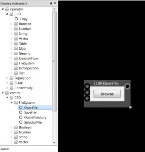</a> 
Figure 22 &#8211; Create control 

1- Identify the control you want to create by browsing or searching the glossary, 
2- Controls are available behind the &#8220;control&#8221; directory and are identified by a <strong>O</strong> icon, 
3- Drag the control&#8217;s name from the glossay and drop it in the composition view, 
4- It creates a control at the dropping position, 
5- You can drag &#038; drop it on the composition view to change its position (also works in multi selection).

<a href="img/Control001.jpg">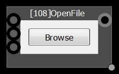</a><a href="img/Control002.jpg">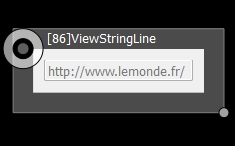</a><a href="img/Control003.jpg">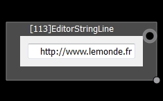</a> 
Figure 23 &#8211; Different kind of controls 

Some controls are just data view, other can just edit &#038; set data (often by pressing enter after edition). An other kind of control can edit datas using inputs datas.

You can resize the control by drag &#038; dropping the little bottom right gray circle.

<h3 style="text-align: left;">Control Menu</h3>

<a href="img/control_composer_menu.jpg">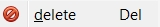</a> 
Figure 25 &#8211; Control Menu 

Delete selected controls.

<h3 style="text-align: left;">Control Connection</h3>

<a href="img/Control_Connection001.jpg">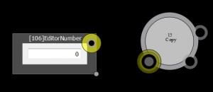</a><a href="img/Control_Connection002.jpg">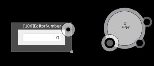</a> 
Figure 24 &#8211; Control connection 

1- Click on a control connector, 
2- See highlighted compatible connectors, 
3- Click on one compatible connectors to connect, 
4- Connector connected to control are identified with a white circle.

<h3 style="text-align: left;">Show control Connection</h3>

<a href="img/Control_Connection003.jpg">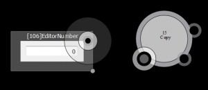</a><a href="img/Control_Connection004.jpg">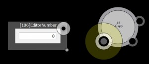</a><a href="img/Control_Connection005.jpg">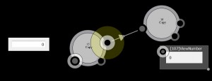</a> 
Figure 26 &#8211; Show connection 

1- Double click on a connector connected to a control, 
2- It highlights the connected connector.

Outputs operator connector can be connected to one operator connector and one control connector. In this case, the output datas can be used by an operator and, also, be viewed by a control.

<strong>Note</strong>: Be careful to data by reference.

 
<strong> 
<h2>Sub-Composition</h2>

<a href="#">back to top</a>
	
</strong>

<h3 style="text-align: left;">Create a sub composition</h3>

<a href="img/sub-process001.jpg">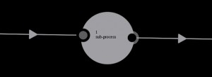</a> 
Figure 27 &#8211; A sub composition 

1- Select more than one component (operator, control, text or shape), 
2- Click left somewhere, 
3- A multi selection menu appears, 
3- Click on &#8220;merge into sub process&#8221;, 
4- It creates a sub process, a gray circle.

<h3 style="text-align: left;">Browse sub process</h3>

<a href="img/sub-process002.jpg">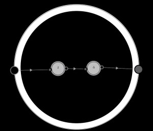</a> 
Figure 28 &#8211; Browse a sub process 

1- Double click on a sub process to get into, 
2- Double click on the sub process background to go to the upscale level.

<h3 style="text-align: left;">Expose a connector</h3>

<a href="img/Expose001.jpg">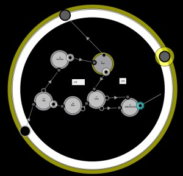</a><a href="img/Expose002.jpg">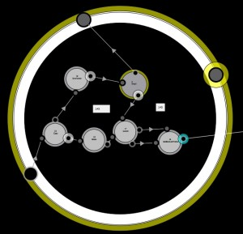</a><a href="img/Expose004.jpg">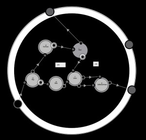</a> 
Figure 29 &#8211; Expose a connector 

1- Drag a connector, 
2- See highlighted compatible connectors and the sub composition highlighted, 
3- Drop your mouse on the sub composition external background, 
4- It create a new connector bridge on the sub composition and connect the connector to it.

<h3 style="text-align: left;">Expose a connector (alternative)</h3>

<a href="img/Expose003.jpg">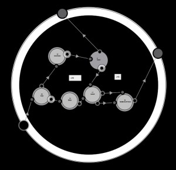</a> 
Figure 55 &#8211; Expose a connector (alternative) 

1- In a sub composition, drag a connector, 
2- Drop it on a sub composition connector, 
3- Connectors are connected.

<h3 style="text-align: left;">Connect to sub process</h3>

<a href="img/connectto001.jpg">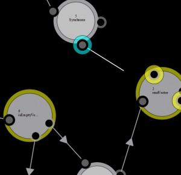</a><a href="img/connectto003.jpg">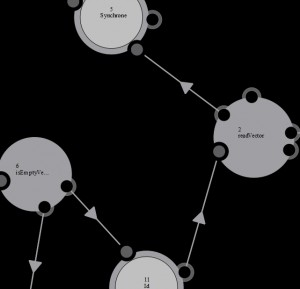</a> 
Figure 56 &#8211; Connect to sub process 

1- At upper scale, drag a connector, 
2- Drop the mouse on a sub composition, 
3- It create a new sub composition bridge &#038; connect the dropped connector to it.

<h3 style="text-align: left;">Sub Process Menu</h3>

Click right on a sub composition to show the sub composition Menu. 

<a href="img/sub-process_Menu1.jpg">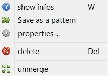</a> 
Figure 30 &#8211; Sub Process Menu 

* <strong>show infos</strong>: Show information about the sub process (those information are editable through the properties dialog), 
* <strong>save as a pattern</strong>: Save this sub composition as a reusable pattern (see the pattern directory in the glossary), 
* <strong>properties &#8230;</strong>: Show the properties dialog, 
* <strong>delete</strong>: delete the sub composition, 
* <strong>unmerge</strong>: restore the composition without the sub process.

<h3 style="text-align: left;">Sub Process Properties</h3>

<a href="img/sub-process-properties.jpg">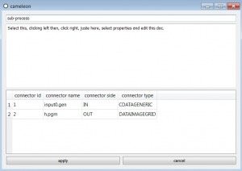</a> 
Figure 31 &#8211; Sub Process Properties Dialog 

* <strong>First edit box</strong>: This is the sub composition name field. You can edit the name here, 
* <strong>Second edit box</strong>: This is a description field. You can write the sub composition description here, 
* <strong>Connector List</strong>: This is the list of all sub composition connectors. The name field is editable, 
* <strong>Apply button</strong>: Click on this button to apply your change, 
* <strong>Cancel button</strong>: Click on this button to discard your change.

<h3 style="text-align: left;">Save as a pattern</h3>

<a href="img/patterns.jpg">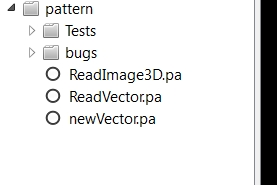</a> 
Figure 57 &#8211; Save as a pattern 

 
When you click on save as pattern on the sub composition menu, it create a new entry under the &#8220;pattern&#8221; directory in the glossary.

<h3 style="text-align: left;">Create a pattern</h3>

 
Figure 35 &#8211; Create a pattern 

1- Identify the pattern you want to create by browsing or searching the glossary, 
2- Operators are available behind the &#8220;pattern&#8221; directory and are identified by a <strong>O</strong> icon, 
3- Drag the pattern&#8217;s name from the glossay and drop it in the composition view, 
4- It creates a sub composition at the dropping position, 
5- You can drag &#038; drop it on the composition view to change its position (also works in multi selection).

Like for operator, you can change a connector&#8217;s position by drag &#038; dropping it.

<h3 style="text-align: left;">Create a pattern directory</h3>

Click right on the pattern directory or on an other directory under pattern and click on add directory. Select a name and it will create a new directory under the selected clicked right directory.

For sub directories or patterns, 
1- click right on a sub directory or a pattern, 
2- select rename menu to rename the directory or the pattern, 
3- select delete menu to delete the directory or the pattern.

<h3 style="text-align: left;">Organize patterns</h3>

Drag &#038; drop pattern names or directories to organize patterns.

 
<strong> 

<h2>Text &#038; Shape</h2>

<a href="#">back to top</a>
	
</strong>

<h3 style="text-align: left;">Create a shape</h3>

 
Figure 32 &#8211; Create a shape 

1- Click on the shape mode button, 
2- Drag your mouse from somewhere on the composition view, 
3- It draws like a selection square, 
4- Drop your mouse to define the size of the shape, 
5- Click on the composition mode button, 
6- By drag &#038; drop, move the shape position, 
7- By drag &#038; dropping little circle on the bottom right, you can change the shape size.

<h3 style="text-align: left;">Write a text</h3>

 
Figure 33 &#8211; Write a text 

1- Click on the text mode button, 
2- Right click somewhere on the composition view, 
3- Write your text, 
4- Click on the composition mode button, 
6- By drag &#038; drop, move the text position,

<h3 style="text-align: left;">Shape &#038; Text Menu</h3>

 
Figure 39 &#8211; Shape &#038; Text Menu 

Delete selected shape and text.

 
<strong> 

<h2>Navigation</h2>

<a href="#">back to top</a>
	
</strong> 

 
Figure 34 &#8211; Zoom in &#038; out 

* Hold the Q key on the keyboard and drag &#038; drop your mouse to change the composition view position, 
* Hold the Q key on the keyboard and use the wheel of the mouse to zoom in &#038; zoom out.

 
<strong> 

<h2>Controller</h2>

<a href="#">back to top</a>
	
</strong>

The controller is used to create functional interface prototype usable without using the composer.

 
Figure 40 &#8211; Controller 

* <strong>Player Bar</strong> [Fig. 5]: Start, pause &#038; stop the engine. You can either launch the engine step by step. 
* <strong>Mode Bar</strong> [Fig. 6]: Three editing modes are available; composition (arrow icon), shape (square icon) &#038; text (A icon). 
* <strong>Comment Bar</strong> [Fig. 7]: Set up text &#038; shape style &#038; color. 
* <strong>Glossary Tree</strong> [Fig. 4]: The glossary is like a component repository. You can create component from here. 
* <strong>Project Tree</strong>: The project tree expose your prototype structure. You can navigate through sub processes &#038; interfaces. You can add or delete interfaces. 
* <strong>Interface View</strong>: The black center square. This is the place to create operators, controls &#038; set up compositions.

<h3 style="text-align: left;">Controller&#8217;s glossary</h3>

 
Figure 40 &#8211; Controller&#8217;s glossary 

The controller&#8217;s glossary is a tree list view which exposed all components which can be created with the controller. 
* <strong>Control</strong>: Set of all available controls.

<h3 style="text-align: left;">Create a control</h3>

Figure 42 &#8211; Create a control 

1- Identify the control you want to create by browsing or searching the glossary, 
2- Controls are available behind the &#8220;control&#8221; directory and are identified by a <strong>O</strong> icon, 
3- Drag the control&#8217;s name from the glossay and drop it in the composition view, 
4- It creates a control at the dropping position, 
5- You can drag &#038; drop it on the composition view to change its position (also works in multi selection).

<h3 style="text-align: left;">Control Menu</h3>

 
Figure 41 &#8211; Control Menu 

* persist: If active, the control will be available at the same position in all interface (see <a href="http://">create an interface</a>), 
* delete: Delete the control, 
* disconnect all: Disconnect all control connectors.

<h3 style="text-align: left;">Connect a controller control to an operator</h3>

 
Figure 43 &#8211; Controller control connection 

1- Click on a control connector on the controller window, 
2- See highlighted compatible connectors on the composer window, 
3- Click on one compatible connectors to connect, 
4- Connector connected to control are identified with a white circle.

Note: Be careful to find the right position &#038; size for both controller window &#038; composer window. We must see both the to composition view &#038; the interface view to connect correctly a control on the controller side to an operator on the composer side.

You can double click on the connected connector to see highlighted connected connector. 

 
<strong> 

<h2>Project</h2>

<a href="#">back to top</a>
	
</strong>

The project tree (right part of the composer or the controller) can be shown or hided using menu <strong>windows </strong>> <strong>project tree</strong> action.

 
Figure 44 &#8211; Project #1 

The project tree allows to browse composer sub compositions or controller interfaces. It allows to create sub processes or interfaces.

<h3 style="text-align: left;">Browse processes</h3>

 
Figure 55 &#8211; Project #2 

Double click on a process (<strong>O</strong> icons) to show the corresponding process on the composer. 
The top process (named &#8220;process&#8221;) goes to the main top composition.

<h3 style="text-align: left;">Browse interfaces</h3>

Double click on a process (<strong>Square green</strong> icons) to show the corresponding interface on the controller. 
The interface under pattern (named &#8220;creation&#8221;) goes to the main interface.

<h3 style="text-align: left;">Create an interface</h3>

 
Figure 54 &#8211; Creation icons 

Click on the <strong>square green plus</strong> icon to create a new interface. A pop-up to set up its name will appear.

<h3 style="text-align: left;">Create a sub process</h3>

Click on the <strong>blue/green graph node</strong> icon to create a new sub process. A pop-up to set up its name will appear. 
The sub composition is created at the center of the current composition/sub composition.

<h3 style="text-align: left;">Project directory</h3>

A project directory must be created by user for each new project. The save as feature must be used in this directory. For instance, we save as a new project named &#8220;project_name&#8221; in an empty project_name directory. The directory is composed of those sub-directories &#038; files:

<pre>
project_name/log
project_name/ressource
project_name/target
project_name/tmp
project_name/project_name.cm
</pre>

The log directory contain the cameleon.log file (and maybe others). In case of a crash, this file can be usefull to analyse the problem. Log output is configurable through the Project Properties Logs dialog. 
The ressource diretory is used to put all datas file used by the project. To share a project, it&#8217;s usefull to have a place to put those data sources (images, raw files, videos etc.). 
The target directory is <em>deprecated</em>. 
The tmp directory contain data file copy produced by the composition. 
The project_name.cm file is the XML file descriptor of the project (reference to operators, data, controls, interfaces &#038; sub compositions).

 
<strong> 

<h2>Properties</h2>

<a href="#">back to top</a>
	
</strong>

<h3 style="text-align: left;">Cameleon Properties Options</h3>

 
Figure 45 &#8211; Cameleon Properties Options 

* Instance path: The instance path, 
* Pattern path: Patterns are stored here, 
* Plugins path: deprecated, 
* Dictionaries path: dictionaries shared libraries are stored here, 
* Projects path: project must be saved here, 
* Ressources path: unstable, 
* Auto-save step number: Number of action to launch an auto-save.

<h3 style="text-align: left;">Caméléon Properties Dictionaries</h3>

 
Figure 46 &#8211; Caméléon Properties Dictionaries 

Table: 
* name: The dictionary name, 
* path: The dictionary path, 
* version: (error) The version or an error message if miss loaded, 
* activated: enable or disable the dictionary (need a Caméléon restart).

<h3 style="text-align: left;">Project Properties Options</h3>

 
Figure 47 &#8211; Project Properties Options 

* project name 
* project version 
* tmp path 
* log path 
* projects path 
* ressources path 
* target directory 
* connectors behavior: debug tool 
* max threads: disabled because unstable

<h3 style="text-align: left;">Project Readme</h3>

 
Figure 48 &#8211; Project Readme 

The project readme editable text box.

<h3 style="text-align: left;">Project Properties Logs</h3>

 
Figure 49 &#8211; Project Properties Logs 

Firet section: 
* log enabled check box: Enable or disable all logs.

Table: 
* component name: Log component are autonomous log which focus on specifics parts of the Caméléon execution. 
* log level: You can select your log level or shutdown a log component.

<h3 style="text-align: left;">Sub process properties</h3>

 
Figure 50 &#8211; Sub process properties 

* First edit box: This is the sub composition name field. You can edit the name here, 
* Second edit box: This is a description field. You can write the sub composition description here, 
* Connector List: This is the list of all sub composition connectors. The name field is editable, 
* Apply button: Click on this button to apply your change, 
* Cancel button: Click on this button to discard your change.

 
<strong> 

<h2>Error</h2>

<a href="#">back to top</a>
	
</strong>

<h3 style="text-align: left;">Highlighted</h3>

 
Figure 51 &#8211; Highlighted 

When an error occurs, Caméléon highlight in red erroneous components.

<h3 style="text-align: left;">Browse error</h3>

 
Figure 52 &#8211; Error list 

You can browse error using the Execution problems tab on Caméléon Outputs (bottom part of the composer). 
Double click on an error id show on the composer or controller the component where the error occurs.

<h3 style="text-align: left;">Lock pop-up</h3>

Figure 53 &#8211; Lock pop-up 

At stop or pause, a Lock pop-up may appears when a component has not yet finished its work. You can press the save &#038; restart button to relaunch Caméléon. It may be useful in debug mode when components has some infinite execution problems.

 
<strong> 

<h2>Command Line Interface (CLI)</h2>

<a href="#">back to top</a>
	
</strong> 
In a command line (use git bash on windows), in the instance/bin directory, you can launch a composition like this:

<pre>
./cameleon-cli.exe -mode=&quot;CLI&quot; -cm=&quot;../project/yourProject.cm&quot;
</pre>

The help menu can be displayed with:

<pre>
./cameleon-cli.exe -h

NAME
        Cameleon program launcher
SYNOPSIS
        ide.exe [options]
DESCRIPTION
        If no option is specified, it launch the .cm file specified in the Caméléon instance file
        -h:      print this help or print the .cm file help if -cm option is specified
        -cm=[.cm file path]:     launch a specific .cm file
        -mode=[IDE, GUI, CLI]:   set the Caméléon mode
                IDE:     launch Caméléon creator in IDE mode,
                GUI:     launch Caméléon app with the related GUI interface (only controller windows),
                CLI:     launch Caméléon in a command line mode (without any GUI),
EXAMPLES
        Standard launch with full IDE    cameleon.exe
        See the help of a specified .cm file     cameleon.exe -h -cm=&quot;../project/tutorial/example-0XY-Arguments/example-0XY-Arguments.cm&quot;
        Launch a specified .cm file with full IDE        cameleon.exe -cm=&quot;../project/tutorial/example-0XY-Arguments/example-0XY-Arguments.cm&quot;
        Launch a specified .cm file in command line application mode     cameleon.exe -mode=&quot;CMD&quot; -cm=&quot;../project/tutorial/example-0XY-Arguments/example-0XY-Arguments.cm&quot;
        Launch a specified .cm file in GUI application mode      cameleon.exe -mode=&quot;GUI&quot; -cm=&quot;../project/tutorial/example-0XY-Arguments/example-0XY-Arguments.cm&quot;
</pre>

<!-- You can start editing here. -->

