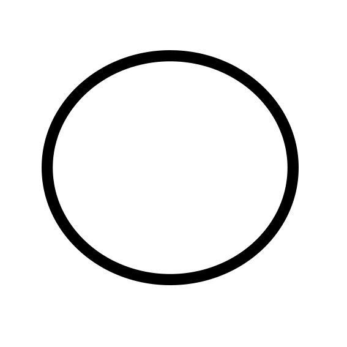

> Cette documentation est soumise à amendements. Si vous souhaitez contribuer à son amélioration, n'hésitez pas à faire une proposition, soit:
> * en saisissant une demande de changement ici: [Demande de changement](issues)
> * en proposant un merge-request en suivant la procédure ici: [Guide du contributeur](./guide_contribution.md)

Documentation pour les utilisateurs
-------------------
* [Introduction](./introduction.md)
* [Grammaire](./grammaire.md)
* Installation [debian](./installation_debian.md) [windows](./installation_windows.md)
* Usage - [Génération d'un site web](./usage_site.md)
* Usage - [Traitement de photos avec imagemagick](./usage_image.md)
* Usage - [Capatation et traitement de données avec python](./usage_twitter.md)
* Tutoriel - bases
* Tutoriel - SCD / Les types standards
* Tutoriel - SCD / Intéragir avec le système
* Tutoriel - SCD / Génériques et flux de contrôle
* Tutoriel - SCD / Manipuler une page web
* Tutoriel - SCD / Manipuler des images
* Tutoriel - SCD / Caméléon en mode CLI
* Tutoriel - SCD / Caméléon en mode GUI
* [Manuel de référence](./notice.md)

Documentation pour les développeurs
-------------------
* [Guide du contributeur](./guide_contribution.md)
* Compilation [debian](./compilation_debian.md) [windows](./compilation_windows.md)
* Empaquetage [debian](./empaquetage_debian.md) [windows](./empaquetage_windows.md)
* [Spécification](./spec.md)
