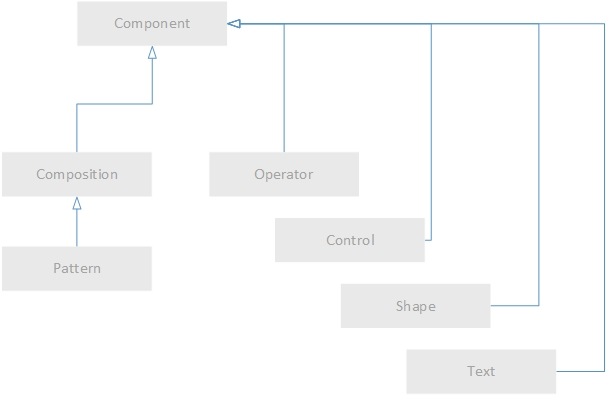
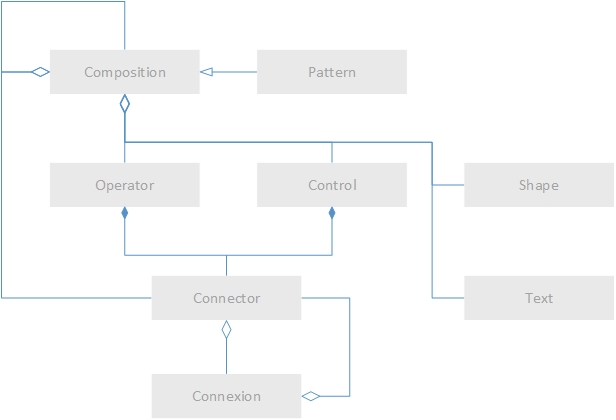
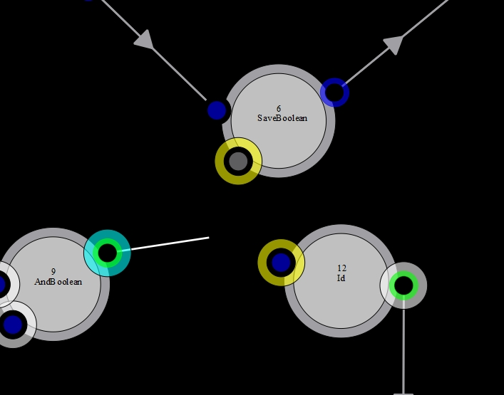

<h1>m2c</h1>
<strong>Méta Modèle</strong> d'un langage de programmation fonctionnelle, <strong>Caméléon</strong>.  
m2c version 0.1.2 (alpha draft) du 14/11/2014 par O. Cugnon de Sévricourt  

<h2>Introduction</h2>
m2c permet de décrire une composition du langage Caméléon. 
Une composition fonctionnelle est une suite ordonnée et structurée de fonctions et d'écrans permettant l'exécution d'un processus métier particulier. 
 
m2c se base sur l'article "<a href="http://arxiv.org/abs/1110.4802">Cameleon language Part 1: Processor</a>" par O. Cugnon de Sévricourt et V. Tariel. 
 

<h2>Le modèle</h2>
Nous présentons deux modèles: un modèle se focalisant sur l'héritage entre concepts et un modèle graphique (diagramme de classe UML) se focalisation sur les compositions entre concepts. 
Nous détaillons ensuite les différents concepts.  
   

<i>Figure 1 - Modèle de dérivation</i>
  
   

<i>Figure 2 - Modèle de composition/agrégation</i>
  

<h3>Le concept de composant, &lt;component&gt</h3>
Dans Caméléon, tout est composant. 
 
Un composant est: 
- un operateur &lt;operator&gt, 
- ou un controlleur &lt;control&gt, 
- ou une composition &lt;composition&gt, 
- ou une forme graphique &lt;shape&gt, 
- ou un texte d'illustration &lt;texte&gt. 
 
Une composition peut avoir été instancié à partir de l'un de ses dérivés instanciables, un schéma &lt;pattern&gt;. 
 

<strong>Remarque</strong>  
Il nous a semblé essentiel d'inclure certains éléments d'illustration (textes et formes) dans les composants constitutifs du langage. 
 

<h3>Le concept de composition, &lt;composition&gt</h3>
Une composition est un agréga de composants. 
Chaque composant a une position dans l'espace. Une implémentation spécifique a une représentation graphique particulière de chaque composant. 
 
 
Une composition peut inclure d'autres compositions. On parle de compositions inférieure pour les compositions incluses dans la composition courante. On parle de composition supérieure pour identifier la composition qui inclus la composition courante. 
 
<strong>Remarque</strong> 
Chaque composant possède une représentation graphique ainsi qu'une position dans l'espace. 
Leur position et leur forme peuvent être déterminantes dans la compréhension de la composition. 
 

<h3>Le concept d'opérateur, &lt;operator&gt</h3>
Un opérateur est l'équivalent d'une fonction  
	* état 
	* condition d'execution 
	* fonction 
	* connecteurs (entrée & sortie) 
 

<h3>Le concept de connecteur, &lt;connector&gt</h3>
Un connecteur ... 
	* état 
	* donnée 
 

<h3>Le concept de connection, &lt;connexion&gt </h3>
 

<h3>Le concept de controlleur, &lt;control&gt</h3> 
Un controlleur est l'équivalent d'un écran. Il peut avoir des connections en entrée et en sortie portant des structures de données de tous types. Une interaction utilisateur permet de modifier les données d'entrée afin de produire des données sortie. 
Cela peut également être une simple vue constituée uniquement de données de sorties ou un éditeur sans données d'entrée. 
	* fonction abstraite exécutée par l'utilisateur 
	* connecteurs (entrée & sortie) 
 
Pour un controlleur, la condition d'exécution équivaut à la condition d'exécution standard d'un opérateur.</strong> 
 
Remarque: Il est possible de décrire une équivalence &lt;operator&gt/&lt;control&gt.</strong> 
 

<h3>Le concept de schéma, &lt;pattern&gt</h3> 
Un schéma implémente une composition instanciable à volonté (ie, pas de connection direct avec des composants inclus dans une composition supérieure). 
 

<h3>Le concept de forme graphique, &lt;shape&gt</h3>

<h3>Le concept de texte d'illustration, &lt;text&gt </h3>

<h2>L'implémentation spécifique Caméléon</h2>
La version actuelle (2.x.y) du langage Caméléon, implémentée par O. Cugnon de Sévricourt et V. Tariel, n'implémente pas rigoureusement m2c car m2c a été conçu en parallèle de la fabrication de Caméléon.  
Nous avons exposer précédemment le modèle conceptuel qu'il faut distinguer de l'implémentation spécifique de m2c réalisée dans le cadre de la fabrication de la version graphique de Caméléon. 
 
Nous faisons ici le rapprochement entre le modèle conceptuel décrit plus haut et la structure des fichiers représentant une composition et un pattern. 
Nous partirons d'exemples concrèts réalisé à l'aide de Caméléon. Nous exposons, pour chaque exemple, le rapprochement méta modèle/structure de fichier ainsi que la représentation graphique réalisée avec le langage.

<h3>Une composition élémentaire</h3>

   

<h2>Références</h2>
* BPEL: http://fr.wikipedia.org/wiki/Business_Process_Execution_Language 
* YAWL: http://fr.wikipedia.org/wiki/YAWL 
* BPMN 1.X 
* UML 2.0 
 
 